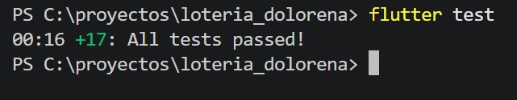
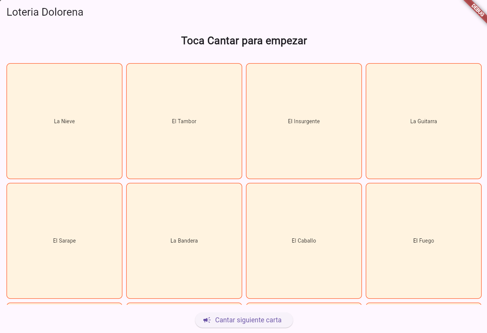
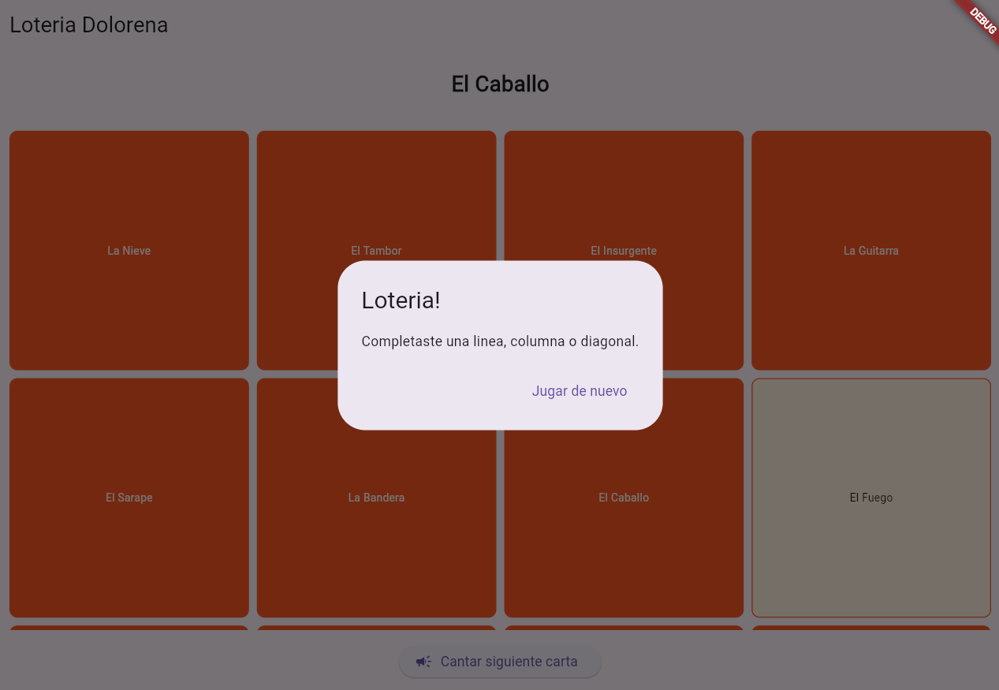

# Lotería Doloreña (Práctica TDD)

Práctica escolar desarrollada en Flutter aplicando la metodología TDD (Test-Driven Development)[cite: 1].

## Evidencia

### Pruebas exitosas (`flutter test`)

### Aplicación Corriendo (`flutter run`)

